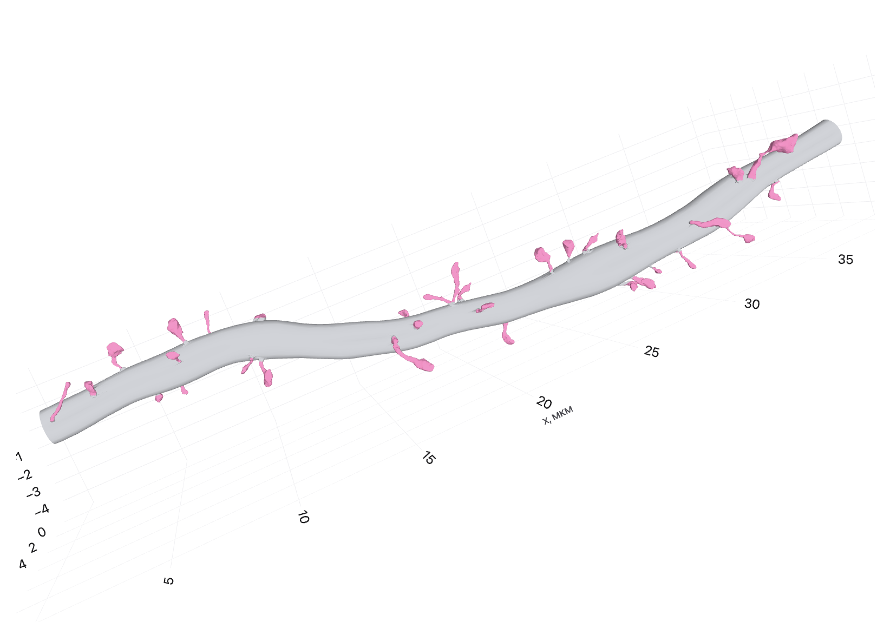
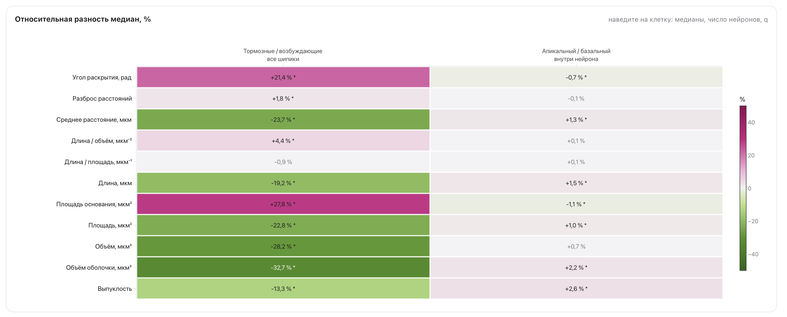
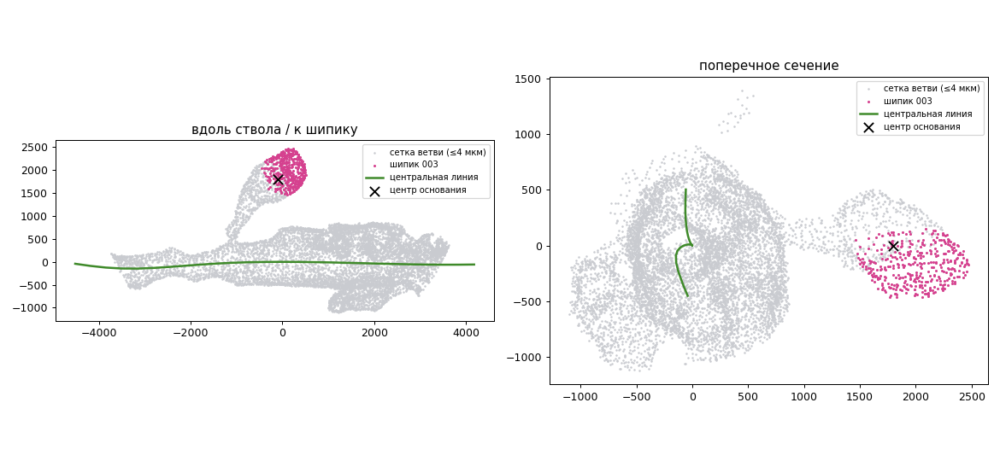

# Отчёт за 26.10–01.11

**Проект:** «Цифровой двойник нейрона»
**Команда:** 7

---

## Цели спринта

- Полная предобработка ветвей Minnie65, переобучение T0 и P0 на полной выборке и на замороженном разбиении по нейронам.
- Устранение оставшихся расхождений модели T0 (разброс радиуса вдоль ветви, изгиб) и выяснение причины заниженной плотности шипиков.
- Статистическая проверка отличий сгенерированных ветвей от реальных.
- Условная генерация шипиков: проверка того, различаются ли реальные шипики по условиям, обучение условной модели и проверка использования условия.
- Подключение данных H01 (мозг человека) и завершение обработки LabID с поправкой масштаба по оси $z$.

---

## Этап 1. Полная предобработка ветвей и итоговое разбиение

Предобработка ветвей выполнена для 734 нейронов Minnie65. Из 140 977 объединённых ветвей успешно обработаны 100 542:
- 19 293 короче 2 мкм
- для 21 142 не удалось построить центральную линию (в основном это ветви длиной 2–5 мкм, на которых слишком мало достоверных сечений). 

Для обучения модуля T пригодны 67 204 ветви, для модуля P 73 663, положение на стволе определено у 89% шипиков. Медианная длина ветви составляет 27,5 мкм, медианный радиус 148 нм.

---

## Этап 2. Модель T0: радиус и изгиб ствола

### Разброс радиуса вдоль ветви

В прошлом спринте было установлено, что модель теряет колебания радиуса на масштабе 0,5–8 мкм. Предположение о том, что колебания создают аксоны нейронов без таблицы компартментов, не подтвердилось: на ветвях с известным компартментом полувариограмма логарифма радиуса и коэффициент вариации те же (отношение сгенерированной изменчивости к реальной 0,42 на 4 мкм). Следовательно, дефект структурный.

Остаток радиуса был заменён суммой двух компонент с разной памятью и белого шума, подбираемых по объединённой полувариограмме. Первая попытка с двумя экспоненциальными компонентами не удалась (относительная ошибка подгонки 53%, одна компонента схлопнулась). Причина в классе модели: реальная полувариограмма гладкая, типичное изменение радиуса растёт почти линейно с расстоянием до 2 мкм и насыщается около 4 мкм, как у дифференцируемого процесса, тогда как экспоненциальное ядро даёт рост, пропорциональный корню из расстояния. Отчасти гладкость порождена самой предобработкой, в которой радиус сглаживается сплайном шириной 1 мкм. Поэтому первой компонентой выбран гауссов процесс (ядро $\sigma^2 e^{-(h/\ell)^2}$), выборка которого строится циркулянтным вложением.

С гауссовой компонентой (масштаб 2,64 мкм, амплитуда 0,132, медленная компонента 0,114, белый шум 0,003) ошибка подгонки полувариограммы снизилась с 0,53 до 0,061. Отношение сгенерированной изменчивости к реальной составляет 0,92–0,99 на всех расстояниях (раньше 0,43 на 2–4 мкм), коэффициент вариации радиуса у тонких ветвей 0,122 против 0,133 у реальных (было 0,082). Остаётся завышенная изменчивость у толстых ветвей (от 500 нм, 7 % выборки): её амплитуда в модели почти не зависит от радиуса, а у реальных ветвей убывает.

### Изгиб ствола

На полной выборке после исправления радиуса изгиб тонких ветвей оказался занижен до 0,58–0,64 от реального на масштабе 0,5–2 мкм, а извилистость длинных ветвей завышена (для ветвей от 50 мкм 1,36 против 1,13, девяностый процентиль 2,2 против 1,27). Полувариограмма изгиба реальных ветвей насыщается уже около 1 мкм с небольшим превышением на 2 мкм. Такая форма соответствует гладким колебаниям оси с шумом центров сечений, а не накоплению поворотов.

Поэтому наклон касательной к оси ветви теперь описывается суммой трёх слоёв: медленной части с возвратом к оси (прежняя модель), гладкого гауссова процесса масштаба около 2 мкм и белого шума наклона в узле. Амплитуда ветви остаётся случайным эффектом, общим для всех слоёв. Параметры подбираются одновременно по двум объединённым полувариограммам, изгиба и наклона, а модельные кривые вычисляются через спектры с учётом дискретной производной на шаге узлов.

На 3000 проверочных ветвях среднее $W_1/\sigma$ по шести функционалам ствола снизилось с 0,526 до 0,223 (шумовой пол 0,08), доля принятых образцов выросла с 87 до 98 %. Извилистость по классам длины составляет 1,04 / 1,10 / 1,155 против 1,03 / 1,08 / 1,13 у реальных ветвей (девяностый процентиль длинных ветвей 1,38 против 1,27 при прежних 2,2), среднеквадратичный изгиб 2,32·10⁻⁴ против 2,24·10⁻⁴ нм⁻¹, автокорреляция изгиба 0,39 против 0,37. Оценённые параметры: масштаб гладкой компоненты 2,1 мкм, длина возврата к оси 6 мкм, амплитуда ветви убывает с радиусом как $r^{-0{,}93}$. Совместная подгонка двух кривых остаётся компромиссом (ошибка 0,30): кривая наклона воспроизводится, а полувариограмма изгиба на расстояниях от 2 мкм завышена. На итоговом разбиении результат воспроизвёлся: среднее $W_1/\sigma$ 0,220 при шумовом уровне 0,041.

---

## Этап 3. Модель P0 и плотность шипиков

### Рассогласование популяций

Заниженная примерно вдвое плотность шипиков в собранных ветвях, отмеченная в прошлом спринте, оказалась в значительной части следствием того, что модели обучались на разных выборках. T0 обучалась только на ветвях с известным компартментом, а P0 и эталонная выборка включали также ветви нейронов без таблицы компартментов, среди которых много тонких ветвей без шипиков. Поэтому у эталона пусты 53 % ветвей, а у сгенерированных 22 %. После обучения P0 на той же выборке, что и T0, плотность составила 0,229 против 0,297 шипика на микрометр.

Разбор 200 пар «реальная ветвь — сгенерированная ветвь тех же условий» показал, что пустота ветви определяется прежде всего её радиусом. Реальные ветви тоньше 150 нм пусты всегда, при 150–200 нм пусты в половине случаев, а при 250–300 нм пустых нет и медиана составляет 39 шипиков. Модель числа шипиков реагировала на радиус слишком плавно, поэтому число базисных функций сплайна по радиусу увеличено с 5 до 9, а штраф гладкости уменьшен с 1 до 0,1. Правдоподобие на проверке улучшилось с 2,317 до 2,218 на ветвь, плотность длинных ветвей выросла с 0,27 до 0,36 при реальных 0,45.

### Проверка модели P0 на реальных стволах

Чтобы разделить вклады модулей, шипики были сгенерированы моделью P0 на реальных стволах проверочных ветвей (400 ветвей итогового разбиения). В этом режиме P0 воспроизводит число шипиков (медиана 5 против 5, $W_1/\sigma=0{,}09$ при шумовом уровне 0,13), плотность (0,229 против 0,254), долю пустых ветвей (0,33 против 0,31) и положения вдоль ветви. Следовательно, оставшееся расхождение при полностью сгенерированных ветвях (плотность 0,263 против 0,370) вносит модель ствола.

### Радиус и расстояние до сомы

У реальных ветвей доля пустых растёт с расстоянием до сомы (40 % на 100–200 мкм, 88 % дальше 400 мкм), и дистальные ветви тонкие. Средний радиус в T0 от расстояния до сомы не зависел, поэтому сгенерированные дистальные ветви получали типичный радиус, и P0 давала им шипики. В дизайн среднего профиля радиуса добавлены логарифм расстояния до сомы, признак отсутствия этого расстояния и признак концевой ветви. Эффект оказался малым: плотность 0,271 против 0,370 (было 0,263). Распределение радиуса реальных ветвей несимметрично в логарифмической шкале: у него тяжёлый хвост в сторону тонких ветвей (пятый процентиль 107 против 141 нм у модели, доля ветвей не толще 150 нм 18,5 % против 7,5 %). Нормальное распределение пары параметров профиля радиуса с линейным средним сдвигает всё распределение целиком и не может выделить отдельную группу тонких ветвей.

Поэтому для пары параметров профиля реализована смесь экспертов: $p(\theta\mid x)=\sum_k \pi_k(x)\,\mathcal N(\theta;\,B_k^\top x,\,S_k)$, где вероятность компоненты $\pi(x)$ задаётся мультиномиальной логистической регрессией по тем же условиям. Модель подбирается EM-алгоритмом, число компонент выбирается по BIC, а при одной компоненте она совпадает с прежней. 

---

## Этап 4. Статистическая значимость отличий

До сих пор отличия сгенерированных ветвей от реальных оценивались нормированным расстоянием Васерштейна и сравнивались с шумовым полом. Чтобы ответить на вопрос, значимо ли отличие, для каждого функционала строится 95-процентный доверительный интервал разности медиан перевыборкой нейронов: ветви одного нейрона похожи, поэтому единицей перевыборки служит нейрон, а не ветвь. Наивный критерий Колмогорова-Смирнова, считающий ветви независимыми, даёт для тех же данных p-значения до $10^{-36}$, в том числе для функционалов, у которых интервал по нейронам включает ноль, то есть объявил бы значимыми почти все различия.

Результаты на 400 полностью сгенерированных ветвях (62 нейрона проверочной части) приведены в таблице.

| Функционал | Разность медиан (сгенерированные минус реальные) [95 % ДИ] | Значимо |
| --- | --- | --- |
| Число шипиков на ветвь | −3 [−6; +1] | нет |
| Плотность шипиков, на мкм | −0,098 [−0,163; −0,030] | да |
| Средний радиус, нм | −14,5 [−34; +9] | нет |
| Отношение радиусов концов | −0,006 [−0,042; +0,021] | нет |
| Коэффициент вариации радиуса | +0,004 [−0,006; +0,013] | нет |
| Среднеквадратичный изгиб | +2,1·10⁻⁵ (+10 %) | да |
| Автокорреляция изгиба | −0,008 [−0,063; +0,041] | нет |
| Извилистость | +0,014 [+0,005; +0,025] | да |
| Положение шипика вдоль ветви | +0,013 [−0,004; +0,029] | нет |
| Расстояние до ближайшего соседа, нм | −94 [−179; −32] | да |
| Интервал между соседними шипиками, нм | −200 [−362; −48] | да |

Ствол воспроизводится хорошо: радиус, его разброс и автокорреляция изгиба значимо не отличаются, а значимые отличия изгиба и извилистости малы (10 и 1,3%). Значимо отличаются плотность шипиков и регулярность их расположения: у реальных ветвей шипики стоят равномернее. Разбивка по радиусу подтверждает механизм, описанный выше: у реальных ветвей тоньше 200 нм пусты 94%, у сгенерированных 36%, причём тонких сгенерированных ветвей больше (25 против 14%), а ветви радиусом 200–300 нм у реальных заметно гуще (медиана 36 шипиков против 15).

---

## Этап 5. Сборка ветвей итоговыми моделями

Сборка 50 ветвей итоговыми T0 и P0 (обучены на итоговом разбиении, шипики из модели MoGen A с выбором по радиусу ствола) дала 48 ветвей без замечаний; 98 % ветвей представляют собой одну замкнутую поверхность. Из 794 запрошенных шипиков поставлено 788.

*Рис 1. Пример собранной ветви.*

---

## Этап 6. Условная генерация шипиков

### Различаются ли реальные шипики по условиям

Модель имеет смысл обучать с условием, только если реальные шипики при разных значениях условия действительно различаются. Для каждой из 11 морфометрик проведена проверка на всех 846 тысячах шипиков 735 нейронов. Единицей сравнения служит нейрон (медиана метрики по его шипикам), а значимость оценивается перестановочным тестом. Типы клеток сравниваются перестановкой меток между нейронами. Компартменты сравниваются внутри нейрона: для каждого нейрона, у которого есть оба компартмента, берётся разность медиан, а нулевое распределение получается сменой знаков. Множественные сравнения учтены поправкой Бенджамини — Хохберга.

Тормозные и возбуждающие клетки значимо различаются по 10 метрикам из 11, и эффекты большие: у тормозных шипики короче (длина на 19% меньше), меньше по объёму (на 28%) и площади (на 23%), но с более широким основанием (на 28%) и большим углом раскрытия (на 21%), то есть короткие и широкие. Подробные типы клеток (10 типов, в каждом не менее 10 нейронов) различаются по всем 11 метрикам, причём сильные различия есть и внутри возбуждающих: у клеток 4P шипики длиннее, чем у 6P-CT, на 27,5%, и длиннее, чем у тормозных клеток BPC, на 49%. Компартменты внутри нейрона значимо различаются по 7 метрикам, но эффекты составляют 1–2%, то есть практически компартмент на форму шипика не влияет.

При этом выяснилось, что в таблице компартментов Minnie65 нет ни одной тормозной клетки (есть 621 из 1188 возбуждающих и 0 из 164 тормозных). Поэтому сравнение типов клеток внутри одного компартмента невозможно. Это согласуется с нейробиологией: деление дендритов на апикальные и базальные определено для пирамидных нейронов, у интернейронов его нет. Однако у этого есть следствие для модулей T и P: исключив ветви без компартмента, мы исключили из обучения T0 и P0 все 72 тормозных нейрона, и генерация ствола и шипиков с условием «тормозная клетка» сейчас не обучена.

*Рис 2. Cводная карта различий морфометрик по типу клетки и компартменту.*

### Условная модель

Условная модель MoGen A обучена на итоговом разбиении (старт с предобученных весов, 60 тысяч обучающих шипиков, 30 000 шагов) с блоком «тормозная / возбуждающая клетка». Средняя потеря на проверке с условием и без него совпала, но это ожидаемо: тормозные шипики составляют 2,6 % выборки, и среднее их не чувствует. Поэтому использование условия проверялось на равном числе шипиков каждого типа при одинаковом шуме: если подставить неверный тип, потеря должна расти. На обучающих шипиках рост составил 0,00045 ± 0,00018 для возбуждающих и 0,00033 ± 0,00018 для тормозных, то есть условие выучено, но слабо. На проверочных шипиках (всего 51 тормозной шипик) эффект в пределах шума. Сопоставление с анализом реальных шипиков показывает, что дело не в отсутствии различия, а в обучении: модель редко видит тормозные шипики.

Для следующей версии вектор условий дополнен блоком подробного типа клетки (13 типов Minnie65 и 3 типа H01). Вход условий предобученной модели имеет ширину 22, поэтому он расширен новыми столбцами с нулевыми весами. Подробный тип при обучении пропускается чаще остальных блоков (с вероятностью 0,4), чтобы модель умела генерировать и по одному двоичному типу, а тормозные шипики выбираются чаще их доли в данных (около 14 % вместо 2,6 %).

### Вариационный автокодировщик

Для проверки того, можно ли улучшить выборку из VAE, подготовлены диагностика латентного пространства и нормализующий поток. Диагностика сравнивает разброс сгенерированных форм для многократных проходов одного шипика с разбросом между разными шипиками, а также сравнивает морфометрики реконструкций реальных шипиков с самими шипиками. Последнее задаёт потолок: если реконструкции уже систематически отличаются от оригиналов, никакой выбор приора этого не исправит. Нормализующий поток (RealNVP с начальным отбеливанием по подогнанной гауссиане) обучается на кодах реальных шипиков и заменяет стандартный нормальный приор. На реальной модели эти инструменты ещё не запускались.

---

## Этап 7. Данные H01 и LabID

### H01

Подключён набор H01 (кора головного мозга человека, электронная микроскопия): 88 нейронов, около 52 тысяч шипиков, из них 56 пирамидных нейронов, 8 шипиковых непирамидных и 24 интернейрона. Первая предобработка шипиков потеряла 30% шипиков на этапе запаивания: запаянная сетка оставалась незамкнутой. Причина оказалась в исходных сетках: у шипиков H01 есть оторванные фрагменты из 1–9 треугольников (меньше 3% площади) и дублированные треугольники, из-за которых часть рёбер принадлежит более чем двум граням, и заполнение отверстий не может сделать такую поверхность замкнутой. Перед запаиванием теперь удаляются точные дубли треугольников и связные компоненты меньше 5% граней. После повторной обработки запаяны 99% шипиков, облака точек и морфометрики получены для 50 538 из 51 968.

Предобработка ветвей H01 дала 14 649 объединённых ветвей, из которых пригодны для модуля T 3 270, для модуля P 4 072. Для 21 % шипиков центр основания оказался далеко от поверхности ствола (у Minnie65 7%), причём это не дефект отдельных нейронов: у половины нейронов таких шипиков больше 26%. Визуальный разбор показал, что в сегментации H01 у части шипиков отдельным объектом сохранена только головка, а шейка осталась в сетке ствола, поэтому найденное основание лежит на стыке головки и шейки, в 1–3 мкм от ствола. Для модуля P это не критично: положение вдоль ветви и угол такого шипика определяются правильно. Для модуля S такие шипики без шейки, их длина и объём занижены, поэтому смешивать их с полными шипиками при обучении нельзя. Остатки шеек в сетке ствола, вероятно, объясняют и большую долю недостоверных сечений ствола у H01.

*Рис 3. Шипик H01, у которого сегментирована только головка: сетка ветви серая, шипик розовый, центральная линия зелёная, центр основания отмечен крестом.*

### LabID

Научные сотрудники лаборатории подтвердили размер вокселя 0,025 × 0,025 × 0,1 мкм и поправку по оси $z$ с коэффициентом 0,7. Проверка на сырых сетках показала, что поправка нужна группам Wt и Ab: отношение вертикального размера шипика к горизонтальному у них 1,5 против 1,05 у групп с веществом 9009, а $1{,}5\cdot0{,}7\approx1{,}05$. Серия Wt_old и после поправки остаётся растянутой (около 2,4) и в анализ не включается. После поправки число ветвей, пригодных для модуля T, выросло с 33 до 44, для модуля P с 70 до 82.

---

## Результаты спринта

- Выполнена полная предобработка ветвей Minnie65 (734 нейрона, 67 тысяч ветвей для T, 74 тысячи для P), T0 и P0 переобучены на итоговом разбиении по нейронам.

- Модель T0 воспроизводит изменчивость радиуса на всех масштабах (гауссова компонента остатка) и изгиб ствола (три слоя наклона): среднее $W_1/\sigma$ по функционалам ствола снизилось с 0,53 до 0,22.

- Найдена причина заниженной плотности шипиков (рассогласование выборок T0 и P0, а затем нехватка тонких дистальных ветвей в T0), P0 на реальных стволах воспроизводит число, плотность и положения шипиков.

- Введена проверка значимости отличий с перевыборкой нейронов: значимо отличаются плотность шипиков и регулярность их расположения, ствол значимо не отличается по радиусу и его разбросу.

- Показано, что реальные шипики сильно различаются по типу клетки и практически не различаются по компартменту, обучена условная модель MoGen на итоговом разбиении и подготовлена её версия с подробным типом клетки.

- Подключён набор H01: устранена причина потери 30% шипиков при запаивании, выполнены предобработка шипиков и ветвей, обнаружены шипики без шейки. Данные LabID предобработаны с подтверждённой поправкой по оси $z$.

---

## Планы

1) Обучить T0 со смесью экспертов для профиля радиуса, повторить генерацию и проверку значимости.

2) Проанализировать влияние типа клетки и компартмента на параметры ствола и плотность шипиков так же, как для морфометрик шипиков, и решить, как включить тормозные нейроны в T и P.

3) Проверить правило определения апикального дендрита по направлению к поверхности коры на Minnie65 и, если согласие с существующей разметкой высокое, применить его к H01.

4) Обучить условную модель MoGen с подробным типом клетки и проверить условность сравнением морфометрик сгенерированных шипиков разных типов с реальными различиями.

5) Отметить шипики H01 без шейки и решить, как использовать H01 в модулях S и P.
